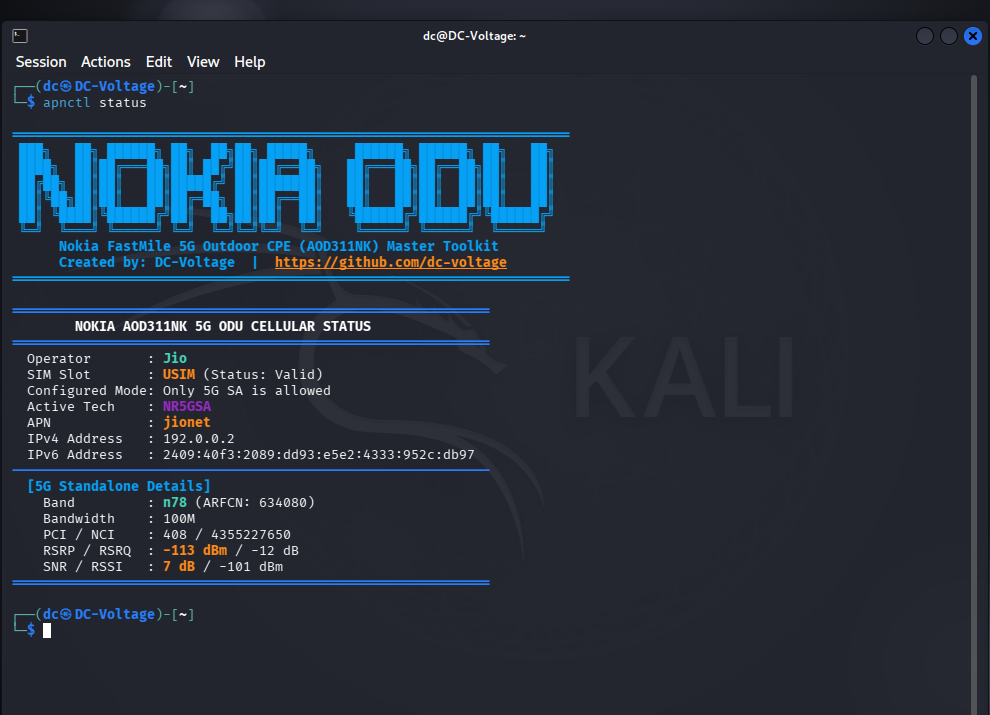

# Nokia FastMile 5G Outdoor CPE (AOD311NK) Toolkit — `apnctl`

[](https://github.com/dc-voltage)
[-orange.svg)](#supported-hardware)
[](#license)

<p align="center">
  
</p>

A standalone, all-in-one management, APN unlock, and 5G band-locking toolkit for the **Nokia FastMile 5G Outdoor Unit (AOD311NK)** used by Airtel AirFiber in India.

---

## 📋 Table of Contents
1. [Overview & Motivation](#-overview--motivation)
2. [Supported Hardware & Firmware](#-supported-hardware--firmware)
3. [Key Features](#-key-features)
4. [Hardware & Network Setup](#-hardware--network-setup)
   - [Connecting via Laptop (Linux / Windows)](#connecting-via-laptop)
   - [Connecting via 3rd-Party Router (OpenWrt / ASUS / TP-Link)](#connecting-via-3rd-party-router)
5. [Installation](#-installation)
6. [Command Reference & Usage](#-command-reference--usage)
   - [1. Lock to 5G SA Band n78 (Jio True 5G)](#1-lock-to-5g-sa-band-n78-jio-true-5g)
   - [2. Reset to Auto Mode (5G SA + NSA)](#2-reset-to-auto-mode-5g-sa--nsa)
   - [3. Lock to 4G LTE Only](#3-lock-to-4g-lte-only)
   - [4. Modify APN (Jio, BSNL, Vi, Airtel)](#4-modify-apn-jio-bsnl-vi-airtel)
   - [5. Live Cellular RF Telemetry](#5-live-cellular-rf-telemetry)
   - [6. Device Information](#6-device-information)
   - [7. Full Configuration Backup Export](#7-full-configuration-backup-export)
   - [8. Remote Clean Reboot](#8-remote-clean-reboot)
7. [The Physical SIM (Jio) Reboot Issue Explained](#-the-physical-sim-jio-reboot-issue-explained)
8. [Security & Privacy](#-security--privacy)
9. [Author & Credits](#-author--credits)

---

## 🔍 Overview & Motivation

The **Nokia AOD311NK** is a high-performance Qualcomm-based 5G Outdoor CPE deployed by Bharti Airtel for AirFiber fixed-wireless broadband. By default, the ISP firmware enforces several restrictions:

1. **APN Locked:** Hardcoded to `airtelfwamdu.com`. If you insert an external SIM (such as Jio or BSNL), data sessions fail to establish because the network rejects the Airtel APN.
2. **eSIM Boot Priority:** The ODU contains an embedded onboard eSIM profile. On cold boot or power cycle, the firmware queries the eSIM first (`esimStatus is Valid`), while bypassing the external physical SIM tray (`usimStatus is None`).
3. **Band Locking Restrictions:** 4G LTE is restricted to `B1, B3, B40`, locking out Jio's primary low-band coverage (**Band 5 / 850 MHz**) and 5G low-band (**n28 / 700 MHz**).
4. **Trunk Port Enforcement:** The Ethernet PoE interface communicates via tagged **VLAN 1999**, making it invisible to standard untagged network devices.

**`apnctl`** solves all these challenges directly from the terminal with a single, standalone, compiled binary without needing to open the device or solder UART wires.

---

## 🏷️ Supported Hardware & Firmware

| Parameter | Value |
| :--- | :--- |
| **Manufacturer** | Nokia Corporation |
| **Product Class** | Fixed Wireless Access (FWA) |
| **Model Name** | **AOD311NK** (FastMile 5G Receiver) |
| **Hardware Version** | `3TG03366AAAA` |
| **Software Version** | `AOD311NK_R4.0` (and compatible variants) |
| **Default Gateway IP** | `192.168.0.1` |
| **Management VLAN** | **VLAN 1999** |

---

## ⚡ Key Features

* **Zero-Config Auto Serial Detection:** Automatically queries the gateway's pre-login API to retrieve the hardware Serial Number and authenticates with zero manual password entry.
* **One-Click 5G SA (Band n78) Lock:** Instantly switches the modem into pure **NR5GSA** mode, attaching to Jio's **100 MHz Band n78** high-speed channel.
* **Dynamic APN Switcher:** Modify active PDN contexts in real-time to `jionet`, `bsnlnet`, `airtelfwamdu.com`, or custom enterprise APNs.
* **Live RF & Telemetry Engine:** View live RSRP, RSRQ, SNR, RSSI, Cell ID, PCI, NCI, ARFCN, and assigned dual-stack IPv4/IPv6 addresses.
* **Remote Power Cycle:** Cleanly reboots the ODU over software without physically disconnecting the PoE injector on the roof.
* **Configuration Snapshot Exporter:** Back up all active WAN, LAN, firewall, cellular, and TR-069 configurations into structured JSON.
* **Tamper-Proof Standalone Binary:** Built as an optimized ELF 64-bit binary. Runs without Python dependencies and cannot be altered in plaintext.

---

## 🔌 Hardware & Network Setup

Because the Nokia 311NK ODU uses **VLAN 1999** on its PoE Ethernet port, clients must tag their traffic accordingly.

### Connecting via Laptop

#### Linux (Ubuntu / Kali / Debian):
```bash
# 1. Bring up physical Ethernet
sudo ip link set dev eth0 up

# 2. Create VLAN 1999 sub-interface
sudo ip link add link eth0 name eth0.1999 type vlan id 1999
sudo ip link set dev eth0.1999 up

# 3. Request IP via DHCP from ODU (assigns 192.168.0.x)
sudo dhclient -v eth0.1999
```

#### Windows:
1. Open **Device Manager** → Expand **Network Adapters** → Right-click your Intel/Realtek NIC → **Properties**.
2. Go to **Advanced** tab → Set **VLAN ID** to `1999` (or use Realtek/Intel PROSet Diagnostic Utility to create a tagged VLAN 1999 virtual adapter).
3. Set IPv4 to Obtain Automatically (DHCP) or Static `192.168.0.100` / Subnet `255.255.255.0` / Gateway `192.168.0.1`.

---

### Connecting via 3rd-Party Router

To distribute 5G internet across your home using a regular Wi-Fi router (OpenWrt, AsusWRT, TP-Link):

1. **OpenWrt:**
   - Go to **Network** → **Interfaces** → **Devices** → Add VLAN device `wan.1999`.
   - Assign `wan.1999` to the **WAN** interface (DHCP client).
2. **TP-Link / Asus (IPTV/VLAN Mode):**
   - Enable **IPTV / VLAN** in WAN settings.
   - Set **Internet VLAN ID** = `1999` (Priority `0`).

---

## 🚀 Installation

### Option 1: Using Precompiled Binary (Recommended)
```bash
# Clone the repository
git clone https://github.com/dc-voltage/airtel-nokia-311nk.git
cd airtel-nokia-311nk

# Install binary to system PATH
sudo cp apnctl /usr/local/bin/apnctl
sudo chmod +x /usr/local/bin/apnctl

# Verify installation
apnctl --help
```

### Option 2: Running via Python
```bash
pip install requests urllib3
python3 apnctl_master.py --help
```

---

## 🛠️ Command Reference & Usage

```text
======================================================================
 ███╗   ██╗ ██████╗ ██╗  ██╗██╗ █████╗     ██████╗ ██████╗ ██╗   ██╗
 ████╗  ██║██╔═══██╗██║ ██╔╝██║██╔══██╗   ██╔═══██╗██╔══██╗██║   ██║
 ██╔██╗ ██║██║   ██║█████╔╝ ██║███████║   ██║   ██║██║  ██║██║   ██║
 ██║╚██╗██║██║   ██║██╔═██╗ ██║██╔══██║   ██║   ██║██║  ██║██║   ██║
 ██║ ╚████║╚██████╔╝██║  ██╗██║██║  ██║   ╚██████╔╝██████╔╝╚██████╔╝
 ╚═╝  ╚═══╝ ╚═════╝ ╚═╝  ╚═╝╚═╝╚═╝  ╚═╝    ╚═════╝ ╚═════╝  ╚═════╝ 
      Nokia FastMile 5G Outdoor CPE (AOD311NK) Master Toolkit
      Created by: DC-Voltage  |  https://github.com/dc-voltage
======================================================================
```

### 1. Lock to 5G SA Band n78 (Jio True 5G)
Locks the cellular radio into Standalone (SA) mode, forcing it to drop 4G LTE anchors and latch directly onto Jio's **Band n78 (3500 MHz, 100 MHz Bandwidth)**:
```bash
apnctl n78
```
*Output:*
```text
[*] Switching Cellular Access Mode to: Only 5G SA is allowed (Band n78)...
[+] SUCCESS! Mode applied: Only 5G SA is allowed (Band n78)
```

---

### 2. Reset to Auto Mode (5G SA + NSA)
Restores default dual-connectivity mode (Both 5G Standalone and Non-Standalone allowed):
```bash
apnctl auto
```

---

### 3. Lock to 4G LTE Only
Restricts the modem to 4G LTE bands only:
```bash
apnctl lte
```

---

### 4. Modify APN (Jio, BSNL, Vi, Airtel)
Set the primary PDP context APN instance:
```bash
# Set APN for Reliance Jio
apnctl set jionet

# Set APN for BSNL 4G/5G
apnctl set bsnlnet

# Set APN for Vodafone Idea (Vi)
apnctl set portalnmms

# Reset to Airtel Default
apnctl set airtelfwamdu.com
```

To view current APN instances and assigned IP addresses:
```bash
apnctl get
```

---

### 5. Live Cellular RF Telemetry
Inspect live radio signal conditions, band allocation, and network parameters:
```bash
apnctl status
```
*Output Example:*
```text
============================================================
        NOKIA AOD311NK 5G ODU CELLULAR STATUS        
============================================================
  Operator       : Jio
  SIM Slot       : USIM (Status: Valid)
  Configured Mode: Only 5G SA is allowed
  Active Tech    : NR5GSA
  APN            : jionet
  IPv4 Address   : 192.0.0.2
  IPv6 Address   : 2409:40f3:xxxx:xxxx:xxxx:xxxx:xxxx:xxxx
------------------------------------------------------------
  [5G Standalone Details]
    Band         : n78 (ARFCN: 634080)
    Bandwidth    : 100M
    PCI / NCI    : 408 / 4355227650
    RSRP / RSRQ  : -109 dBm / -11 dB
    SNR / RSSI   : 10 dB / -104 dBm
============================================================
```

---

### 6. Device Information
Display hardware model, firmware build, and masked modem identifiers:
```bash
apnctl info
```
*Output Example:*
```text
============================================================
             NOKIA AOD311NK DEVICE DETAILS           
============================================================
  Manufacturer   : Nokia
  Model / Class  : FWA (AOD311NK)
  Serial Number  : ANKODA1F000*****
  Hardware Ver   : 3TG03366AAAA
  Software Ver   : AOD311NK_R4.0
  IMEI           : 351830656333***
  eSIM ICCID     : 89918620400355*****
  System Uptime  : 3482 seconds
============================================================
```

---

### 7. Full Configuration Backup Export
Export all router parameters (WAN, LAN, Cellular, TR-069, Firewall) into a timestamped JSON file:
```bash
apnctl backup
```

---

### 8. Remote Clean Reboot
Reboot the ODU safely from your workstation:
```bash
apnctl reboot
```

---

## 💡 The Physical SIM (Jio) Reboot Issue Explained

### Why does a physical Jio SIM require re-inserting (hot-plug) after reboot?

In the Airtel firmware logs (`LOG.CellularMgr`):
```text
GetCellularNetworkIdentification: usimStatus is None, esimStatus is Valid
GetCellularNetworkIdentification: getESIMProfilesObject find esim profile, iccid is 899110...
```

1. **Boot Priority:** During power-on or reboot, the baseband driver prioritizes the soldered onboard **eSIM profile** (`esimStatus is Valid`). The physical SIM tray (`usimStatus`) is left unpowered.
2. **The Hot-Plug Interrupt:** When you pull out the physical SIM tray and push it back in while the ODU is powered on, the mechanical tray switch triggers a hardware GPIO interrupt (`SIM_DETECT`).
3. This interrupt forces the Qualcomm modem baseband to handle a **"SIM State Change"**, switching the active slot from eSIM to the external **USIM slot**, latching onto Jio!

> **Tip:** Once locked to `apnctl n78` with APN `jionet`, the ODU maintains a persistent 5G SA latch on Band n78.

---

## 🔒 Security & Privacy

* This tool interacts strictly through legitimate local CGI / OAM endpoints over HTTPS.
* **Privacy Assurance:** No hardware serial numbers, IMEIs, IMSIs, or private location identifiers are transmitted externally. All telemetry stays strictly between your host and the CPE.

---

## 👤 Author & Credits

* **Developer:** **[DC-Voltage](https://github.com/dc-voltage)**
* **Project Repository:** [https://github.com/dc-voltage/airtel-nokia-311nk](https://github.com/dc-voltage)
* **Contributions & Bug Reports:** Open an Issue or Pull Request on GitHub.

---

## 📄 License

This project is licensed under the [MIT License](LICENSE).
